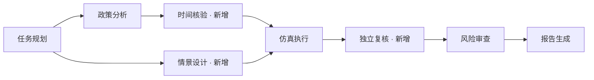

# 流动性支持政策评估：完整自演进演示案例

案例编号：**DEMO-LIQ-01**。用途：产品演示、比赛答辩与项目介绍。建议讲解时长：约 4 分 30 秒。

本案例围绕一项政策评估任务，展示团队如何从初轮执行中发现问题，再修改提示词、工具计划和协作结构，经过复评发布新版本，并把经验用于下一任务。政策、市场价格、评分、时间和执行状态均为专门设计的示例；配套八张图片是在新版前端中实际截取的界面。案例没有调用模型、启动真实实验或写入实验档案。

## 一、任务设定

虚构的市场在第 1—3 个交易步出现流动性收缩，价格短暂下行。研究团队收到一条“流动性支持安排”的政策材料，需要比较三种响应，选出符合预算约束的方案。

**研究问题：面对市场流动性收缩，哪一种干预方案能在预算约束内控制回撤，并形成完整、可复核的证据？**

| 固定输入 | 案例设定 |
| --- | --- |
| 政策公告时间 | 10 月 12 日 |
| 政策生效时间 | 10 月 15 日；与公告时间分别建字段 |
| 观察窗口 | 生效后 10 个交易步；基期记为第 0 步 |
| 情景集合 | 不干预、信息澄清、流动性支持 |
| 初始价格 | 100，作为价格指数基期 |
| 市场初始状态 | 所有候选与情景使用同一市场快照 |
| 随机种子 | 42，仅作为演示契约中的固定条件；合成曲线为明确给定的数据 |
| 干预预算上限 | 1.0 归一化单位 |
| 三情景成本 | 不干预 0；信息澄清 0.2；流动性支持 0.8 |
| 交付内容 | 政策结构、情景比较、风险诊断、引用完整的研究报告 |

这里有两个不同的评价对象：政策情景看风险与预算；智能体配置看工作质量与证据。政策回撤降低与团队评审分提升分别展示，不能混作同一个指标。

任务契约在初轮前锁定。候选可以修改研究方法与协作配置，不能修改政策内容、市场快照、种子、评价权重或工具权限。

## 二、初始团队与初轮产物

初始版本 v1.0 使用五个角色串行协作：

`任务规划 → 政策分析 → 仿真执行 → 风险审查 → 报告生成`

| 角色 | 初轮职责 | 暴露的问题 |
| --- | --- | --- |
| 任务规划 | 拆解政策研究任务，安排报告交付 | 未将核验工作设为前置依赖 |
| 政策分析 | 提取政策方向和关键参数 | 将公告日误填为生效日 |
| 仿真执行 | 运行流动性支持情景，计算风险 | 缺少无干预对照和独立复跑 |
| 风险审查 | 检查产物是否足以支持结论 | 识别四项证据缺口，阻断正式发布 |
| 报告生成 | 汇总结果并准备草稿 | 等待补证，部分段落尚未绑定来源 |

初始指令如下：

> 解析政策内容与方向。运行市场仿真，分析风险。汇总结果，输出研究报告。

初轮在示例时间线上运行 78 秒，计 8 次工具调用：读取政策、解析政策、读取市场快照、校验参数、运行单情景、计算风险、保存草稿产物、执行质量审查。这里的调用列表是案例脚本中的逻辑步骤，不对应实际日志。

| 时间 | 展示事件 | 状态变化 |
| --- | --- | --- |
| 00:00 | 规划员分解任务 | 生成分析和报告计划 |
| 00:12 | 完成政策解析 | 公告日被误作生效日 |
| 00:56 | 返回单一政策情景 | 缺少参照与独立核验 |
| 01:18 | 审查提出补证要求 | 草稿保留，正式报告门禁阻断 |

初轮四维等权评分为 62/100，10 项任务证据中有 6 项通过。界面中“风险审查”处于待补证据状态，“报告生成”处于等待核验状态。

## 三、十项证据与四条反馈

下表编号用于讲解逻辑产物，并不表示已生成相应的真实文件。

| 编号 | 检查对象 | 初轮 | 候选 B 修复后 |
| --- | --- | --- | --- |
| E01 | 政策来源可追溯 | 通过 | 通过 |
| E02 | 公告与生效双时间核验 | 缺失 | 两个字段分别绑定原文 |
| E03 | 参数边界符合契约 | 通过 | 通过 |
| E04 | 市场价格路径已生成 | 通过 | 通过 |
| E05 | 无干预对照可用 | 缺失 | 三情景同条件比较 |
| E06 | 风险计算产物可用 | 通过 | 通过 |
| E07 | 独立复跑可核对 | 缺失 | 入选情景完成独立复跑 |
| E08 | 结论引用完整 | 缺失 | 每条结论对应来源或计算产物 |
| E09 | 干预预算未越界 | 通过 | 0.8 ≤ 1.0 |
| E10 | 结果与配置已归档 | 通过 | 示例发布状态中保留关联信息 |

初轮的 E10 指草稿产物已保存，不代表正式发布。E01 的来源存在也不代表时间字段已正确理解，因此可与 E02 未通过同时出现。

| 反馈 | 定位 | 修复内容 | 验收条件 |
| --- | --- | --- | --- |
| F01：时间混用 | 政策结构缺少 `effective_at` | 增加双时间字段与时间核验员 | 10 月 12 日为公告，10 月 15 日为生效，分别有出处 |
| F02：无参照 | 计划仅要求运行政策情景 | 增加情景设计员和三情景工具步骤 | 三情景使用同一快照、种子与窗口 |
| F03：未复跑 | 执行与核验没有独立角色 | 增加独立复核员，接在执行之后 | 复跑输入一致，关键产物可核对 |
| F04：引用缺失 | 报告要求只描述格式 | 加入逐条引用检查与发布阻断 | 每条关键结论都绑定来源或计算产物 |

演进控制器按四类可修改对象组织修复：P 为提示词约束，U 为工具计划，G 为角色与依赖图，M 为通过复评后保存的经验。资源约束在本案例中固定，避免把预算放宽当作修复。

## 四、提示词与工具计划如何变化

候选 B 的执行指令：

1. 分别提取公告日与生效日，每个字段绑定原文；缺失字段保留为空并提出核验要求，不自行补造。
2. 建立不干预、信息澄清与流动性支持三个情景。
3. 对齐市场快照、随机种子与观察窗口；参数未经验证不得进入执行。
4. 独立复跑入选情景，核对计算产物；不一致时提交差异，阻断正式发布。
5. 逐条检查结论引用，缺少证据时保留草稿并阻断发布。

在初轮 8 次逻辑调用基础上，候选 B 增加五次调用：

| 新增调用 | 解决问题 | 预期产物 |
| --- | --- | --- |
| 双时间与字段来源核验 | F01 | 时间字段核验记录 |
| 无干预情景计算 | F02 | 同条件参照路径 |
| 信息澄清情景计算 | F02 | 第二种可选干预路径 |
| 入选情景独立复跑 | F03 | 复跑产物与一致性检查 |
| 逐条结论引用核验 | F04 | 结论—证据映射与缺失列表 |

更新后的整体顺序为：**时间与来源核验 → 三情景计算 → 独立复跑 → 引用检查 → 报告汇总**。规则写入提示词，步骤写入工具计划，依赖写入团队图；三者共同保证修复能够落实。

## 五、团队从五个角色扩展到八个角色

保留原有五个角色，新增时间核验、情景设计与独立复核。

政策解析与情景模板准备可以独立推进。两条分支在计算前汇合，此时统一采用已核验的生效时间。独立复核接收相同输入重新执行入选情景，不直接沿用执行员的结论。风险审查汇总时间、对照、计算和引用检查，最后决定报告是否可发布。

这张图展示的是一个依赖明确的案例配置。角色增加本身不作为收益；收益由下一阶段的证据补齐与同条件复评体现。

## 六、候选比较与情景可视化

同一任务比较四个配置：

| 配置 | 主要改动 | 事实正确 | 计算一致 | 证据完整 | 资源效率 | 等权总分 | 证据 | 门禁 |
| --- | --- | ---: | ---: | ---: | ---: | ---: | ---: | --- |
| v1.0 | 初始团队 | 60 | 80 | 40 | 68 | 62 | 6/10 | 待修复 |
| A | 仅改提示词，沿用原团队与调度方式 | 84 | 80 | 68 | 80 | 78 | 8/10 | 未通过 |
| B | 完整更新提示词、工具计划与角色依赖 | 96 | 96 | 96 | 80 | 92 | 10/10 | 通过 |
| C | 在 B 的基础上减少独立复核 | 96 | 88 | 72 | 80 | 84 | 9/10 | 未通过 |

总分是四维评分的算术平均。维度评分为预设演示值，资源效率综合表达预算遵守与有效工作占比，并非把耗时直接换算成分数。证据项为二元门禁，质量维度可评价产物的细致程度，因此 10/10 证据与 96 分证据质量不矛盾。

A 补齐双时间与无干预参照，但未完成独立复跑和逐条引用核验。C 保留引用检查但省去独立复核。B 的工具调用由 8 次增至 13 次，示例执行耗时由 78 秒增至 96 秒。演示不声称扩充团队后更快；增加的成本换来了完整的核验链路。

### 合成价格数据

| 交易步 | 不干预 | 信息澄清 | 流动性支持 |
| ---: | ---: | ---: | ---: |
| 0 | 100 | 100 | 100 |
| 1 | 99 | 99.5 | 99.7 |
| 2 | 96 | 97 | 98 |
| 3 | 93.2 | 94.1 | 95.7 |
| 4 | 94 | 95.6 | 97.4 |
| 5 | 95 | 96.8 | 98.6 |
| 6 | 95.6 | 97.9 | 99.8 |
| 7 | 96 | 98.4 | 100.9 |
| 8 | 96.8 | 99.2 | 101.8 |
| 9 | 97.2 | 99.8 | 102.5 |
| 10 | 97.6 | 100.6 | 103.1 |

最大回撤按 `max_t(1 − P_t / max_{s≤t} P_s)` 计算，依次为 6.8%、5.9% 和 4.3%。流动性支持相对不干预降低 2.5 个百分点，成本为 0.8，满足 1.0 的预算上限，因此在本例的风险目标下入选。

图表采用共同坐标，基期为 100，纵轴显示 90—105，直接连接原始示例数据点。三条曲线分别使用灰蓝实线、浅蓝虚线与低饱和青绿实线，便于投屏时区分。这些曲线用于说明比较方法，不代表任何真实政策的实际效果。

## 七、发布与回退规则

候选 B 需要同时满足以下条件，才能在演示状态中晋升为 v1.1：

- 10 项证据全部通过；
- 四维等权总分至少 85；
- 关键阻断项为 0；
- 入选干预方案成本不超过 1.0；
- 保留本次输入、候选配置与评审结果的关联。

示例中 B 达到 92 分、10/10 证据、0 个阻断项，干预成本为 0.8，于是发布 v1.1。版本包括提示词规则、八角色依赖图、前置工具检查以及关联的经验条目。v1.0 保留快照；正在执行的任务继续使用自己的配置快照，后续任务才默认加载新版本。

**回退预案未在本案例中实际触发。**后续候选若跳过独立核验或修改评分规则，直接阻断晋升；已发布版本若出现回归，则撤回并恢复上一稳定快照。保留 v1.0 的快照用于追踪和恢复，不意味着本次缺证据的任务报告可以被重新放行。

## 八、把经验用于下一任务

经验条目 `POLICY-VERIFY-01`：

| 字段 | 内容 |
| --- | --- |
| 适用范围 | 含生效时滞的政策情景评估 |
| 触发问题 | 公告与生效时间混用、对照缺失、独立复核不足、引用缺失 |
| 固化规则 | 双时间与来源先核验；同条件建立政策与参照情景；独立复跑；逐条绑定报告引用 |
| 关联版本 | v1.1，来源为候选 B 的完整修复 |
| 使用条件 | 任务契约和市场模型兼容；数据范围、模型或契约改变时重新验证 |

下一任务为“交易税费调整评估”。规划员检索到这条经验，加载 v1.1 的八角色团队，把对照、复跑与引用核验写入首轮计划。界面明确显示“计划已更新 · 待开始执行”。

本案例结束于新任务计划生成。可展示的闭环是：**经验被保存 → 配置被选用 → 新计划改变**。下一任务尚未执行，因此不展示其评分、耗时或收益提升。

## 九、八页展示脚本与操作

打开“图片演示”中的“团队自演进”图集，点击“打开完整案例”。案例标签支持点击、左右方向键、Home 与 End；底部提供前后翻页。每张图库图片可全屏放大，也可通过“打开此阶段”进入相应页面。

| 页码 | 画面重点 | 建议讲解词 | 时长 |
| --- | --- | --- | ---: |
| 01 任务定义 | 双时间、三情景、预算与结果预览 | “我们用一个流动性支持政策评估，展示完整的团队自演进。研究输入与评分标准一开始就固定，后续只修改工作方法。” | 25 秒 |
| 02 初轮执行 | 五人链路、62 分、6/10 证据 | “初轮已经有分析产物，但审查发现证据不齐。系统把报告留在草稿状态，明确指出还缺什么。” | 30 秒 |
| 03 反馈归因 | F01—F04 与修复责任 | “四个问题分别落在时间、参照、复跑和引用。反馈指向具体配置和责任角色，为下一轮生成可执行的修改。” | 35 秒 |
| 04 策略改写 | 提示词前后、工具顺序 | “新指令把检查写成前置条件，工具计划也同步加入对照和复核。改写的结果会影响下一轮实际怎么做。” | 35 秒 |
| 05 团队重组 | 八人依赖图、三个新增角色 | “时间核验、情景设计和独立复核进入团队。可独立准备的工作并行推进，关键计算前汇合，报告仍经过统一审查。” | 35 秒 |
| 06 候选复评 | A/B/C、三曲线与资源成本 | “同条件下，完整修改的 B 达到 92 分并补齐 10 项证据。调用和耗时也增加了，界面同时展示这笔成本。右侧用三情景比较说明政策选择的依据。” | 45 秒 |
| 07 版本发布 | v1.0 → v1.1、门禁与预案 | “通过门禁后，新配置成为后续任务的默认策略。旧快照保留，运行中的任务不被改写，后续回归也有回退路径。” | 30 秒 |
| 08 经验复用 | 经验条目进入新任务计划 | “这次修复被保存为工作规则。下一项税费政策任务在首次规划时就加载这些检查，自演进由一次修复延续到下一次工作。” | 30 秒 |

合计约 265 秒。开场或结束时可说明：“这是为展示流程而设计的示例，页面中的数据不是实测结果。”每张图自身也有相同性质的标识。

## 十、图片与入口

截图规格为 1600 × 900，深色外观。图片保存在 `static/evolution_story_gallery`，对应的拍摄时间、页面地址与 SHA-256 在 `manifest.json` 中。

| 阶段 | 原图 |
| --- | --- |
| 01 任务定义 | [01-mission.png](../static/evolution_story_gallery/01-mission.png) |
| 02 初轮执行 | [02-baseline.png](../static/evolution_story_gallery/02-baseline.png) |
| 03 反馈归因 | [03-diagnosis.png](../static/evolution_story_gallery/03-diagnosis.png) |
| 04 策略改写 | [04-strategy.png](../static/evolution_story_gallery/04-strategy.png) |
| 05 团队重组 | [05-team.png](../static/evolution_story_gallery/05-team.png) |
| 06 候选复评 | [06-evaluation.png](../static/evolution_story_gallery/06-evaluation.png) |
| 07 版本发布 | [07-release.png](../static/evolution_story_gallery/07-release.png) |
| 08 经验复用 | [08-memory.png](../static/evolution_story_gallery/08-memory.png) |

独立案例入口：`?page=演进案例&chapter=1&appearance=dark`。阶段号可设为 1—8，重新打开链接会直接进入对应阶段。

首页“团队自演进”的八张图片已替换为上述案例截图；原真实实验图片保留在 `static/competition_gallery`。金融政策风洞的八张原项目图片与首页上方的真实实验可视化保持各自的数据来源。
